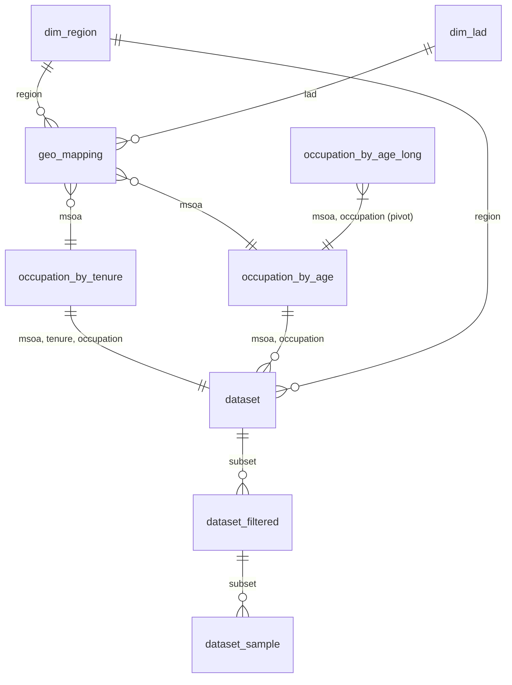

# Census 2021: Occupation, Tenure and Age by MSOA

A small relational dataset built from the 2021 Census for England and Wales. It links
**housing tenure**, **occupation (SOC 2020 major group)** and **age** at the level of
Middle Layer Super Output Areas (MSOAs, neighbourhoods of roughly 2,000 to 6,000 households),
together with a geography lookup up to local authority and region.

It was put together for the paper
[*Rentership ~ Occupation, Analysis*](https://www.alphaxiv.org/abs/2610.rentership-occupation-analysis) on alphaXiv,
which models how occupation and age relate to private renting. Code, including the script that builds the database
(`data_preparation.qmd`): [github.com/prteek/rentership-occupation-analysis](https://github.com/prteek/rentership-occupation-analysis).

The repo holds the same eleven tables in two forms:

- `data/*.parquet`: one Parquet file per table, each exposed as a **config** (subset) so it can be
  loaded with `datasets` and browsed in the dataset viewer.
- `lab.duckdb`: the original DuckDB database that contains all eleven tables.

## Sources

| Source | Publisher | Used for |
|---|---|---|
| **RM140: Tenure by occupation, Household Reference Persons** (Census 2021, edition 2021 v2). <https://www.ons.gov.uk/datasets/RM140/editions/2021/versions/2> | Office for National Statistics | `msoa_tenure_occupation`, `occupation_by_tenure` |
| **RM102: Occupation by age, residents in employment** (Census 2021, edition 2021 v3). <https://www.ons.gov.uk/datasets/RM102/editions/2021/versions/3> | Office for National Statistics | `msoa_occupation_age`, `occupation_by_age_long`, `occupation_by_age` |
| ONS statistical geography codes and names (LSOA → MSOA → LAD → region) | Office for National Statistics (Open Geography) | `geo_mapping`, `dim_lad`, `dim_region` |

The census tables were downloaded as CSV from [Nomis](https://www.nomisweb.co.uk/) on 3 December 2025.

> Source: Office for National Statistics licensed under the Open Government Licence v3.0.
> Contains public sector information licensed under the Open Government Licence v3.0.
> ONS Crown Copyright Reserved.

### Populations measured

The two census tables count **different populations**, so keep this in mind when you combine them:

- **RM140 (tenure)**: *household reference persons* (HRPs) aged 16+ who were in employment in the week before the census. Unit: one HRP per household.
- **RM102 (age)**: *all usual residents* aged 16+ who were in employment in the week before the census. Unit: persons.

The age columns in `dataset` therefore describe the age profile of **all workers** in an
MSOA and occupation, not the age of the HRPs whose tenure is counted.

## Schema and relationships

DuckDB does not enforce keys, so the keys below are logical. They were checked against the
data: every primary key is unique, and the foreign keys have no orphans except where noted.



| Table | Rows | Primary key | Foreign keys |
|---|---:|---|---|
| `dim_region` | 9 | `region` | |
| `dim_lad` | 361 | `lad` | |
| `geo_mapping` | 33,557 | `lsoa` | `region` → `dim_region.region`; `lad` → `dim_lad.lad` |
| `occupation_by_tenure` | 261,504 | (`msoa`, `tenure`, `occupation`) | `msoa` → `geo_mapping.msoa`* |
| `occupation_by_age_long` | 392,256 | (`msoa`, `age`, `occupation`) | `msoa` → `geo_mapping.msoa`* |
| `occupation_by_age` | 65,376 | (`msoa`, `occupation`) | `msoa` → `geo_mapping.msoa`* |
| `dataset` | 209,484 | (`msoa`, `tenure`, `occupation`) | (`msoa`,`tenure`,`occupation`) → `occupation_by_tenure`; (`msoa`,`occupation`) → `occupation_by_age`; `region` → `dim_region.region` |
| `dataset_filtered` | 52,371 | (`msoa`, `occupation`) | same as `dataset` |
| `dataset_sample` | 20,124 | (`msoa`, `occupation`) | same as `dataset` |
| `msoa_tenure_occupation` | 29,056 | (`2021 super output area - middle layer`, `Tenure of household`) | raw source table |
| `msoa_occupation_age` | 43,584 | (`2021 super output area - middle layer`, `Age`) | raw source table |

\* `geo_mapping` is many-to-one on `msoa` (several LSOAs per MSOA), and every MSOA maps to exactly one
`lad` and one `region`. For one row per MSOA, use `SELECT DISTINCT region, lad, msoa FROM geo_mapping`.
404 Welsh MSOAs and 40 English MSOAs in the census tables have no match in `geo_mapping`. These
MSOAs therefore drop out of `dataset` and its subsets.

### Key conventions

- In the tidy tables, all codes and labels are **lower case**: `msoa = 'e02002483'`, `lad = 'e06000001'`,
  `region = 'e12000001'`, `occupation = '1. managers, directors and senior officials'`.
- The two raw tables keep the original Nomis formatting. Their area column combines code and name
  (`'E02002483 : Hartlepool 001'`). To join them to the tidy tables, use
  `lower(trim(split_part("2021 super output area - middle layer", ':', 1)))`.
- `dim_lad` covers all of the UK (England E06/E07/E08/E09, Wales W06, Scotland S12, Northern Ireland N09).
  `dim_region` covers the 9 English regions only.

## Tables

### Lookups

**`dim_region`**: English regions (ITL1).

| Column | Type | Description |
|---|---|---|
| `region` | string | ONS region code (`e12…`) |
| `region_name` | string | Region name, e.g. `north east` |

**`dim_lad`**: local authority districts.

| Column | Type | Description |
|---|---|---|
| `lad` | string | ONS LAD code |
| `lad_name` | string | LAD name, e.g. `hartlepool` |

**`geo_mapping`**: geography hierarchy at LSOA grain (6,820 MSOAs across 252 LADs and 9 regions).

| Column | Type | Description |
|---|---|---|
| `region` | string | Region code |
| `lad` | string | LAD code |
| `msoa` | string | MSOA code (`e02…` / `w02…`) |
| `lsoa` | string | LSOA code (`e01…` / `w01…`) |

### Raw census tables

**`msoa_tenure_occupation`**: RM140 in wide format, stacked across the four tenure blocks of the Nomis download.
It has one row per MSOA × tenure (7,264 MSOAs × 4 tenures). The count columns are
`Total` and the nine `1.` to `9.` SOC major groups. They are stored as **strings**, exactly as
they appear in the file.

**`msoa_occupation_age`**: RM102 in the same layout. It has one row per MSOA × age band
(7,264 × 6), with an `Age` column.

### Tidy tables

**`occupation_by_tenure`**: RM140 in long format. It covers all 7,264 MSOAs in England and Wales and
sums to 15,496,060 HRPs.

| Column | Type | Description |
|---|---|---|
| `msoa` | string | MSOA code |
| `tenure` | string | `owns outright`, `owns with a mortgage or loan or shared ownership`, `social rented`, `private rented or lives rent free` |
| `occupation` | string | SOC 2020 major group, `1. …` to `9. …` |
| `counts_of_hrp` | double | Number of household reference persons |

**`occupation_by_age_long`**: RM102 in long format. It sums to 27,773,627 residents.

| Column | Type | Description |
|---|---|---|
| `msoa` | string | MSOA code |
| `age` | string | `aged 15 years and under`, `aged 16 to 24 years`, `aged 25 to 34 years`, `aged 35 to 49 years`, `aged 50 to 64 years`, `aged 65 years and over` |
| `occupation` | string | SOC 2020 major group |
| `counts_of_residents` | double | Number of usual residents in employment |

**`occupation_by_age`**: `occupation_by_age_long` pivoted wide, with one row per MSOA × occupation.
It has one double column per age band, plus `total`, the sum across all age bands.
The `aged 15 years and under` band is always 0 because the population is aged 16 and over.

### Modelling tables

**`dataset`**: `occupation_by_tenure` joined to `occupation_by_age` on (`msoa`, `occupation`) and
to the geography lookups. **The London region (`e12000007`) is excluded.** It has 5,819 MSOAs
in 234 LADs across 8 regions. Welsh MSOAs drop out because of the `geo_mapping` gap described above.

| Column | Type | Description |
|---|---|---|
| `msoa`, `tenure`, `occupation`, `counts_of_hrp` | | From `occupation_by_tenure` |
| `occupation_total` | double | HRPs in this MSOA × occupation summed over all four tenures. It is the binomial denominator for `counts_of_hrp`. |
| `aged 15 years and under` … `aged 65 years and over` | double | Residents in employment by age band, from `occupation_by_age` |
| `all_ages_total` | double | Total residents in employment in this MSOA × occupation |
| `region` | string | Region code |
| `lad_name` | string | LAD name. The LAD code is not included; get it by joining to `geo_mapping` on `msoa`. |

**`dataset_filtered`**: `dataset` restricted to `tenure = 'private rented or lives rent free'`.

**`dataset_sample`**: a subset of `dataset_filtered` with at most 10 randomly chosen MSOAs per LAD
(2,236 MSOAs, all 234 LADs). This is the exact sample the published analysis was fitted on. It was
drawn with an unseeded `random()`, so re-running the build query gives different rows; use this file
rather than redrawing it.

> **Version note (2026-10-26).** The first upload of this table contained a later redraw that shared only
> 1,272 of these 2,236 MSOAs. It was replaced with the original analysis sample, which was recovered as
> `dataset_filtered` restricted to the MSOAs of the fitted model and checked value by value against it.
> Every other table is unchanged.

## Usage

### 🤗 `datasets`

```python
from datasets import load_dataset

ds = load_dataset("prteek/census-2021-occupation-tenure-age-msoa", "dataset_filtered", split="train")
geo = load_dataset("prteek/census-2021-occupation-tenure-age-msoa", "geo_mapping", split="train")
```

### DuckDB, querying the Hub directly

```sql
-- Attach the whole database
ATTACH 'hf://datasets/prteek/census-2021-occupation-tenure-age-msoa/lab.duckdb' AS lab (READ_ONLY);
SELECT * FROM lab.dataset_sample LIMIT 5;

-- Or join the Parquet tables
SELECT r.region_name,
       t.occupation,
       sum(t.counts_of_hrp) FILTER (WHERE t.tenure = 'private rented or lives rent free')
         / sum(t.counts_of_hrp) AS share_private_rented
FROM 'hf://datasets/prteek/census-2021-occupation-tenure-age-msoa/data/occupation_by_tenure.parquet' t
JOIN (SELECT DISTINCT region, msoa
      FROM 'hf://datasets/prteek/census-2021-occupation-tenure-age-msoa/data/geo_mapping.parquet') g USING (msoa)
JOIN 'hf://datasets/prteek/census-2021-occupation-tenure-age-msoa/data/dim_region.parquet' r USING (region)
GROUP BY ALL
ORDER BY 1, 2;
```

## Limitations

- **Mismatched populations.** Tenure counts are for HRPs, while age counts are for all workers (see above).
- **Employed people only.** Both tables cover people in employment in the week before the census, so
  households whose reference person was not in employment are not counted.
- **Statistical disclosure control.** ONS applies cell-key perturbation to census outputs, so small cells
  are noisy and totals across tables may not match exactly.
- **Coverage.** `dataset` and its subsets exclude London and (because of the geography lookup) Wales and
  40 English MSOAs.
- **Cross-sectional.** These are 2021 data only.

## Citation

If you use this data, please cite the ONS sources:

```bibtex
@misc{ONS2021RM140,
  publisher = {Office for National Statistics},
  title     = {RM140: Tenure by occupation - Household Reference Persons},
  year      = {2023},
  url       = {https://www.ons.gov.uk/datasets/RM140/editions/2021/versions/2},
  note      = {Census 2021. England and Wales}
}

@misc{ONS2021RM102,
  publisher = {Office for National Statistics},
  title     = {RM102: Occupation by age - residents in employment},
  year      = {2023},
  url       = {https://www.ons.gov.uk/datasets/RM102/editions/2021/versions/3},
  note      = {Census 2021. England and Wales}
}
```
